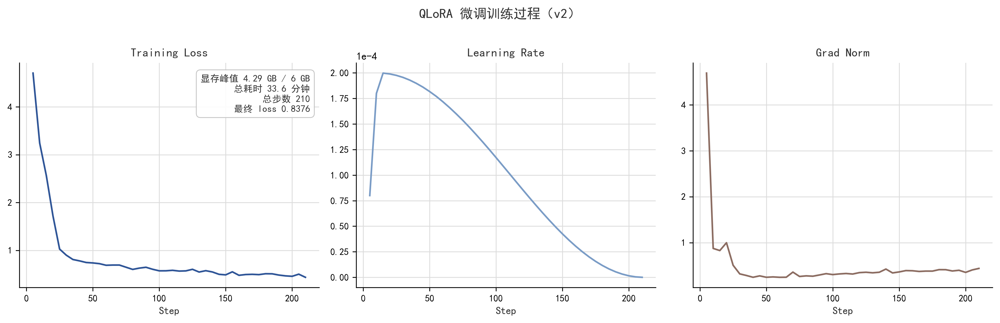
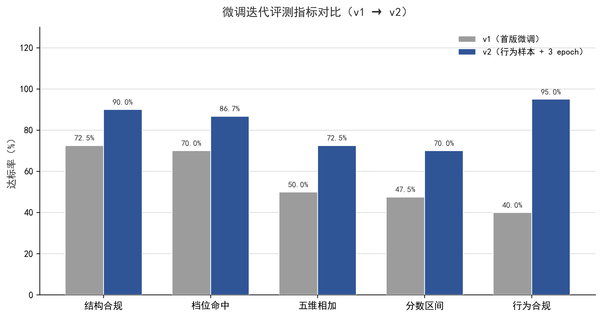

# 微调手册（2026-11-12）— 数据 / 训练 / 成果 / 运行调试

> **本文件是模型微调的唯一入口**（已合并原「微调方案」「开工前文档」「成果与定版选项」三份）。
> 一句话结论：**格式问题基本解决（结构合规 0%→95%），判分能力只到 70%，算术 60%**；模型已切换到运行时（边用边调）。

---

## 一、一页速览

| 项 | 值 |
|---|---|
| 当前运行模型 | **`qwen2.5:3b-defense-v2`**（2026-11-16 切换，加行为样本 + 3 epoch） |
| 配置位置 | `application.yml` → `spring.ai.openai.chat.options.model`（gitignore，不入库） |
| 生效条件 | **必须重启后端** |
| 回退（30 秒） | 逐级回退：`qwen2.5:3b-defense`（v1）→ `qwen2.5:3b-16k`（原始底座），改一行 + 重启。**前提是 tag 还在**——2026-11-17 实查曾只剩 v2，已重建三个 tag 并验证，重建命令见 §11.6 |
| 训练环境 | `D:\应用源文件\AI微调环境`（`env.bat` 激活 / `train.bat` 一键训练 / `README.md` 重建手册） |
| 模型文件 | `F:\ollama\models`（沿用 `OLLAMA_MODELS`；`start_ollama.bat` 无需改动） |
| 数据 | 105 题 × 5 形态 = **518 条**（468 训练 / 50 验证），成本 **¥3~5** |

---

## 二、为什么做（问题证据）

3B 长期不守「点评:/评分:/下一题:」三行协议。20 条验证集实测，原模型**结构合规率 0%**，典型输出：

```
点评: [切题]/数据倾斜就是某些key的数据量特别大/[逻辑分2]
评分: 38/50|表达分4|逻辑分7|专业分13|应变分2|创新分6；
下一题: 如何理解Hive的Combiner？它和MapReduce有什么区别？
```

问题：冒号后带空格与 `/`、维度写成「表达分4」、专业分 13 越界、行尾分号、多出正文。后端正则解析失败 → 压分或走兜底。

**目标只有三个**：① 三行协议稳定；② 档位与分数区间一致；③ 放弃作答不出追问。
**明确不做**：不提升专业深度、不解决短报告区分度、不换更大模型。

---

## 三、数据

### 3.1 题库

`docs/ft/questions-bigdata.json`，**105 题**（现有 25 + 新增 28 + 扩展 52），每题带 `keyPoints`：

| 模块 | 题数 |
|---|---|
| Hadoop/HDFS/YARN/MapReduce | 18 |
| Spark（RDD/SQL/Streaming/调优） | 15 |
| 数仓/Hive/HBase/NoSQL | 17 |
| 采集/ETL（Flume/Kafka/Sqoop/CDC） | 18 |
| 流处理与架构（Flink/湖仓/Lambda） | 12 |
| Hadoop 空气质量课题（topic 28，必选） | 12 |
| 其他（大数据基础、项目实战） | 13 |

### 3.2 五形态 → 档位映射（核心口径）

| form | 回答特征 | 标记 | 总分 | 条数 |
|---|---|---|---|---|
| `fully_correct` | 要点齐、原理正确 | `[切题]` | 35~50 | 104 |
| `half_right` | 主体对、核心一半错 | `[错误]` | 15~30 | 104 |
| `all_wrong_relevant` | 满嘴术语、从头错到尾 | `[错误]` | 5~14 | 104 |
| `irrelevant` | 答另一领域/闲聊/抄题 | `[跑题]` | 0 | 102 |
| `mostly_wrong_few_right` | 1~2 个点对，其余乱 | `[错误]` | 5~20 | 104 |

> **关键取舍：不用 3B 自己的历史评分做标签。** 那是自蒸馏，会把「全对 32 分」等缺陷固化；改由 DeepSeek 按上表生成标签。

### 3.3 生成方式

`scripts/ft/gen-dataset.ps1`：每题 × 5 形态调 DeepSeek（`deepseek-chat`，`response_format=json_object`），结果落 `docs/ft/raw/{题号}-{形态}.json`（存在即跳过，断点续跑），最后切分 `train.jsonl` / `val.jsonl` / `rejected.jsonl`。

**校验硬门槛**：三行顺序、标记合法、评分行正则、每维 0~10、五维和=总分、总分落区间、追问非空。
**成本**：约 550 次调用，输入+输出约 90 万 token，**¥3~5**。

### 3.4 已知数据缺口

- 行为样本（give_up 50 / 末轮总结 50）**未生成**——这是「我不会还追问」未能改善的原因；
- 688 条真实作答未混入（只借语气，标签需重写）。

---

## 四、训练

| 项 | 值 |
|---|---|
| 底座 | `Qwen/Qwen2.5-3B-Instruct`（unsloth 映射到 4bit 变体） |
| 方法 | QLoRA 4bit NF4，LoRA `r=16, alpha=16, dropout=0.05`，target 全部线性层 |
| 可训练参数 | 29,933,568（**0.96%**） |
| 序列 / batch | 1536 / 1（梯度累积 8，等效 8） |
| 精度 | **fp16**（2060 是 Turing，无 bf16） |
| 优化器 | `paged_adamw_8bit` + gradient checkpointing |
| epoch / lr | 2 / 2e-4 cosine，warmup 10 |
| **耗时** | **20.4 分钟**（117 步，约 9~11 秒/步） |
| **显存峰值** | **4.29 GB / 6 GB** |
| loss | 4.69 → 1.129（第 1 轮末 0.76，第 2 轮稳定 0.65~0.70） |

**环境注意**：装 unsloth 会把 torch 升级成 CPU 版，装完必须重装 `torch-2.5.1+cu121` 并验证 `torch.cuda.is_available()`；triton 版本不匹配时 flex attention 会退化（手动设 `attn_implementation="sdpa"`）。

---

## 五、评测结果（20 条验证集，temperature=0，同一 system prompt）

| 指标 | 原模型 `qwen2.5:3b-16k` | 微调版 `qwen2.5:3b-defense` |
|---|---|---|
| **结构合规**（三行+标记+评分行可解析） | **0%** | **95%** |
| 五维和 = 总分 | 0% | 60% |
| 档位标记命中 | 25% | **70%** |
| 分数区间命中 | 0% | 55% |

**学到了**：三行协议、点评引用具体内容、完全不相关→`[跑题]` 0 分。
**没学会**：相关但错误→`[错误]`（常给 `[切题]` 32~42 分，N63/N67 老问题）；五维加法（3B 算术硬伤）。

**两个缺口为什么不致命**：
1. 后端 `DocScoreParser`/`ScorePersistenceServiceImpl` 一律**按五维之和重算总分**，模型自报总分作废 → 60% 不影响入库分数；
2. 判档错误靠既有「低分/跑题云端复核」兜一部分，但**兜不住「错答给高分」**——这是当前最大隐患。

**必须知道的分布风险**：训练用短 prompt（课题+题目+回答），线上用 3000 字长 prompt。长 prompt 下格式是否仍稳，**只能靠真机验证**。

---

---
### 5.1 可视化评估产物
为直观展示微调前后的能力质变，已生成标准化对比图表：
- **训练过程稳定性**：
- **评测指标提升对比**：
*(注：数据源见 `docs/ft/eval/metrics.json`，可通过 `python scripts/ft/visualize.py` 一键重新生成)*
---

## 六、部署形态（为什么不用合并）

```
LoRA adapter (120MB)
  → convert_lora_to_gguf.py → defense-lora.gguf (60MB)
  → Modelfile: FROM qwen2.5:3b-16k + ADAPTER ./defense-lora.gguf
  → ollama create qwen2.5:3b-defense
```

**不走 16bit 合并**：6GB 显存放不下（`ValueError: We need an offload_dir`）；改 CPU 合并又撞 Windows 页面文件上限（`os error 1455`）。
ADAPTER 方案额外显存接近 0，且**原模型完全不动**，回退只是改配置。

Ollama 侧已实测 `/v1/chat/completions` 返回 `model=qwen2.5:3b-defense`（Spring AI 走的就是这条接口）。

---

## 七、运行与反复调试

### 7.1 自证当前模型

成绩单抬头「**评分引擎：本地 qwen2.5:3b-defense**」直接证明；或看后端启动日志。

### 7.2 调试循环

```
① 改数据/参数 → ② 重训 → ③ 转 GGUF → ④ ollama create → ⑤ 重启后端 → ⑥ 重放对比
```

| 想改善 | 改哪里 | 说明 |
|---|---|---|
| 判档不准（错答给高分） | 提高「半对半错 / 少量对掺杂大量错」样本比例，或补真实错答 | **唯一有效方向** |
| 「我不会」仍追问 | 补 give_up 行为样本（需扩 `gen-dataset.ps1`） | 当前缺失 |
| 格式又漂 | 查 `rejected.jsonl` 与训练集是否混入非三行样本 | |
| 分数偏低/偏高 | 调 `app.scoring.*` 或 prompt | **不要靠微调调分** |

命令：

```bat
D:\应用源文件\AI微调环境\env.bat
powershell -ExecutionPolicy Bypass -File f:\杂七杂八\ai\scripts\ft\gen-dataset.ps1 -Limit 5
D:\应用源文件\AI微调环境\train.bat
python D:\应用源文件\AI微调环境\tools\llamacpp\llama.cpp-master\convert_lora_to_gguf.py ^
  D:\应用源文件\AI微调环境\ft-out\adapter --outfile D:\应用源文件\AI微调环境\ft-out\defense-lora.gguf ^
  --outtype f16 --base-model-id Qwen/Qwen2.5-3B-Instruct
ollama create qwen2.5:3b-defense -f D:\应用源文件\AI微调环境\ft-out\Modelfile-defense
:: 重启后端
```

### 7.3 改完必做

1. 离线：`python scripts\ft\eval_ollama.py --model qwen2.5:3b-defense --n 20`
2. 线上重放：`343`（误杀）/ `344`（五形态）/ `359`（标注一致性）/ `363`（连续「我不会」应 **0 条追问**）/ `364`（追问应全相关）
3. 达标线：格式不下降、`363` 仍 0 条追问、`343/359` 无明显退化；否则按 §1 回退

### 7.4 排障关键字

| 现象 | 日志关键字 |
|---|---|
| 某轮没分 | `管道格式不完整`、`未找到管道行` |
| 点评被压到 ≤4 | `缺失`、`⚠️`、`材料未` |
| 报告/视频评析失败 | `解析失败`、`FAILED` |
| 确认用的哪个模型 | `评分引擎：` |

### 7.5 调试记录（每次改往下加一行）

| 日期 | 改了什么 | 训练耗时 | 格式合规 | 档位命中 | 结论 |
|---|---|---|---|---|---|
| 2026-11-12 | 初版：105 题 × 5 形态 518 条；r16 / seq1536 / 2 epoch | 20.4 min | 95% | 70% | 已切换，边用边调 |
| 2026-11-16 | v2：+行为样本 100 条（558/60），epoch 2→3，重跑完成 | 33.6 min | 90% | 86.7% | **已切 v2**；行为合规 95%（v1 40%），见 §11 |

> 只写可复现事实（数字、命令、场次 ID），不写「感觉好些了」。

---

## 八、备选方案与历史决策

| 选项 | 内容 | 结论 |
|---|---|---|
| A 全线切换 | 精简 `chatController` 长 prompt + 切模型 | 格式最稳、推理更快，但要动红线大文件，判档风险大 |
| B 输出规范化 | 旧模型判分 → 微调模型整理格式 | 延迟翻倍，收益被高估，**不推荐** |
| C 分流 | 只让报告/视频两条链路用微调模型 | 改动最小、风险低，**原本建议** |
| D 先不切 | 补行为样本 + 真实作答再训一版 | 零风险，提升不保证 |
| **实际选择** | **用户 2026-11-12 决定全量切换、边用边调** | A 的路径 + D 的迭代方式 |

> 若要改回 C（分流）：`VideoAnalysisServiceImpl` 与 `ReportDocAnalysisServiceImpl` 各注入一处模型名，不碰 `chatController`。

---

## 九、产物与复现

| 东西 | 路径 |
|---|---|
| 题库 / prompt | `docs/ft/questions-bigdata.json`、`docs/ft/system-prompt.txt` |
| 数据集 | `docs/ft/dataset/`（已 gitignore） |
| 脚本 | `scripts/ft/`（生成 / 训练 / 导出 / 评测） |
| 适配器 / GGUF / Modelfile | `D:\应用源文件\AI微调环境\ft-out\` |
| 训练日志 | `D:\应用源文件\AI微调环境\logs\` |
| Ollama 模型 | `qwen2.5:3b-defense`（存于 `F:\ollama\models`） |

**冒烟验证显存**：`python scripts\ft\train_qlora.py --smoke`（10 步，约 2 分钟，峰值 4.29GB）。

---

## 十、风险清单

| 风险 | 影响 | 缓解 |
|---|---|---|
| 短/长 prompt 分布不一致 | 线上格式可能回退 | 首轮真机必看格式与解析日志 |
| 判档 70%（错答给高分） | 分数虚高 | 补错答样本再训；或临时调高云端复核触发范围 |
| 算术 60% | 成绩单自相矛盾 | 后端已按五维重算，无需处理 |
| 数据量 518 条 | 换题易过拟合 | 留出 10% 题组验证；补真实作答 |
| 6GB 显存 | 合并 16bit 不可行 | 固定使用 LoRA-GGUF + ADAPTER |

---

## 十一、v2 迭代（2026-11-16，**已完成并切换**）

### 11.1 结果

| 项 | v1（`qwen2.5:3b-defense`） | **v2（`qwen2.5:3b-defense-v2`）** |
|---|---|---|
| 训练数据 | 518 条（468/50） | **618 条（558/60）**：+100 行为样本 |
| epoch / 步数 | 2 / 117 | **3 / 210** |
| 耗时 / loss | 20.4 min / 1.129 | **33.6 min / 0.838** |
| 结构合规 | 72.5% | **90.0%** |
| 五维和=总分 | 50.0% | **72.5%** |
| 档位标记命中 | 70.0% | **86.7%** |
| 分数区间命中 | 47.5% | **70.0%** |
| **行为合规**（不出追问/必总结） | 40.0% | **95.0%** |

> 评测口径已修正为「与线上一致」：解析前先模拟 `stripPrematureSummary` / `stripNextQuestionFromText`（v2 在放弃作答时会多写一行 `总结:`，后端在非末轮会整段截掉，属无害冗余）。
> 因此 v2 在**所有五项指标上全面优于 v1**，已切换。

### 11.2 中断记录（保留，供复盘）

首轮训练因用户急事在 **130/210 步**手动停止；`adapter-v2-step100` 是当时的快照。
后续尝试 `--resume` 失败：`resume_from_checkpoint` 会读 `optimizer.pt`，transformers 5.x 因 CVE-2025-32434 要求 `torch >= 2.6`，而本机锁定 `2.5.1+cu121`。
**结论：本机不支持断点续训，中断后只能重跑**（已把 `--resume` 参数保留在脚本里，换 torch 后可启用）。

### 11.3 v2 与 v1 的差别（只改了两处）

1. **数据**：新增 `docs/ft/dataset/behavior.jsonl` **100 条**（50 give_up + 50 final_round），训练集从 468/50 变为 **558/60**。
   - give_up：答「我不会」→ `[跑题]` 0 分，第三行必须是 `下一题:`，**不得追问**；
   - final_round：user 段带 `【本轮为最后一轮】`，第三行必须是 `总结:`，不得出现 `下一题:`。
2. **epoch**：2 → **3**（210 步）。

### 11.4 中断后如何继续

**本机只能重跑**（原因见 11.2：`optimizer.pt` 需要 torch≥2.6）。重跑约 33 分钟：

```bat
D:\应用源文件\AI微调环境\env.bat
D:\应用源文件\AI微调环境\train.bat
```

> 脚本已保留 `--resume <checkpoint 目录>` 参数，将来把 torch 升到 ≥2.6 后可直接续训。
> 重跑前确认 `ft-out/adapter` 是 v1（备份在 `adapter-v1`），训练结束会覆盖它。

### 11.5 复现命令（本次实际执行）

```bat
:: 1) 导出 LoRA-GGUF（v2）
python D:\应用源文件\AI微调环境\tools\llamacpp\llama.cpp-master\convert_lora_to_gguf.py ^
  D:\应用源文件\AI微调环境\ft-out\adapter ^
  --outfile D:\应用源文件\AI微调环境\ft-out\defense-lora-v2.gguf ^
  --outtype f16 --base-model-id Qwen/Qwen2.5-3B-Instruct

:: 2) 注册为 v2（不覆盖线上 v1）
ollama create qwen2.5:3b-defense-v2 -f D:\应用源文件\AI微调环境\ft-out\Modelfile-defense-v2

:: 3) 对比评测（40 条 = 20 验证 + 20 行为）
python f:\杂七杂八\ai\scripts\ft\eval_ollama.py --model qwen2.5:3b-defense    --n 20 --behavior
python f:\杂七杂八\ai\scripts\ft\eval_ollama.py --model qwen2.5:3b-defense-v2 --n 20 --behavior

:: 4) 对比通过后切配置（已执行）
::    application.yml → model: qwen2.5:3b-defense-v2
::    然后重启后端
```

### 11.6 回退

| 回退到 | 改一行 + 重启 |
|---|---|
| v1（上一版微调） | `model: qwen2.5:3b-defense` |
| 原始底座 | `model: qwen2.5:3b-16k` |

模型文件都在 `F:\ollama\models`，不需要删任何东西。

> **✅ 2026-11-17 实查与恢复**：切换 v2 之后机上一度**只剩 `qwen2.5:3b-defense-v2` 一个 tag**（v1 与底座被清掉），
> 当时「改一行 + 重启」会直接报模型不存在。现已重建并逐项验证：
> `ollama list` 三个 tag 齐全（`3b-defense-v2` / `3b-defense` / `3b-16k`），v1 实测可加载出词，`num_ctx=16384`、`temperature=0`；
> 线上仍常驻 **v2**（`ollama ps` 100% GPU / 16384 / Forever）。
>
> **若哪天又缺 tag，按下面重建（全离线，blob 复用，不重新下载）**：
>
> ```bat
> :: ① 底座 tag 缺失（v2 manifest 里保留着底座层，blob 都在本机 → 手写一个 manifest 即可，秒级）
> ::    参数层内容 = {"num_ctx":16384}；config 的 diff_ids 去掉 adapter 层
> ::    见 CHANGES.md 2026-11-17「模型库现状与回退能力恢复」一节的做法
>
> :: ② v1 tag 缺失（底座已在的前提下）
> ollama create qwen2.5:3b-defense -f "D:\应用源文件\AI微调环境\ft-out\Modelfile-defense"
>
> :: ③ 校验
> ollama list
> ollama show qwen2.5:3b-defense | findstr /i num_ctx
> ```
>
> **注意**：`ft-out\Modelfile-defense` 的 `ADAPTER` 行原写 `F:/ft-out/defense-lora.gguf`（旧路径，文件实际在 D:），
> 2026-11-17 已改为 `D:/应用源文件/AI微调环境/ft-out/defense-lora.gguf`——重建前先确认这一行。
> 另：`ft-out\qwen2.5-3b-defense-Q4_K_M` 是**残缺的 HF 下载**（只有 index.json，无 safetensors），不能当底座用。

### 11.7 本轮新增/变更的脚本

- `scripts/ft/gen-behavior.ps1`（新增）：行为样本生成，零 API 成本；
- `scripts/ft/eval_ollama.py`（扩展）：`--behavior` 指标 + **模拟后端剥离**（与线上同口径）+ 行为合规统计；
- `scripts/ft/train_qlora.py`（扩展）：并入 `behavior.jsonl`，epoch 默认 3，新增 `--resume`；
- `ft-out/Modelfile-defense-v2`：指向 `defense-lora-v2.gguf`。
